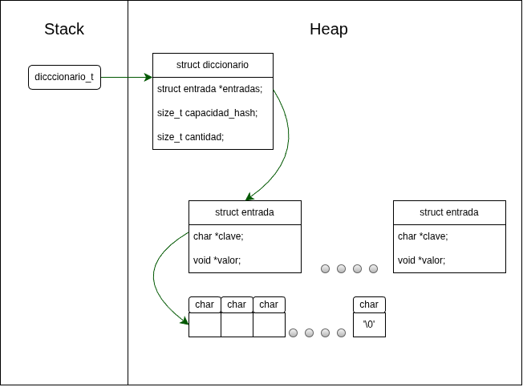
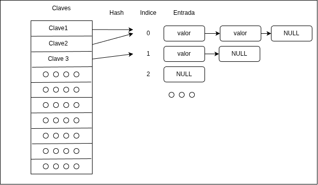
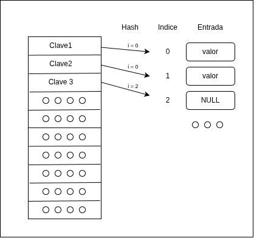
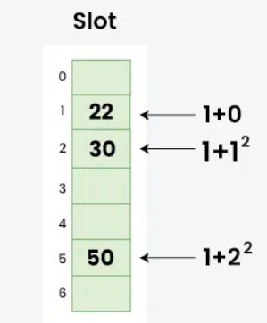
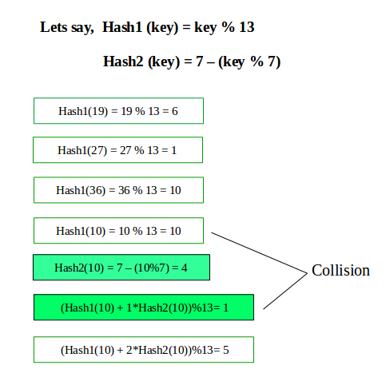

# TP - TDA Diccionario

## Información personal

* **Nombre** = Constantino Valentín Navarro
* **Padrón** = 114821
* **E-mail** = cvnavarro@fi.uba.ar
* **User de github** = cvnavarro06

---

## Índice
* [1. Instrucciones para el uso correcto del programa](#1-instrucciones-para-el-uso-correcto-del-programa)
  * [Compilación](#compilación)
  * [Correr programa](#correr-programa)
  * [Correr valgrind](#correr-valgrind)
* [2. Funcionamiento](#2-Funcionamiento)
* [3. Estructura](#3-Estructura)
  * [3.1. Diagrama de memoria](#31-Diagrama-de-memoria)
  * [3.2. Análisis de complejidades](#32-Análisis-de-complejidades)
* [4. Decisiones de diseño y/o complejidades de implementación](#4-Decisiones-de-diseño-yo-complejidades-de-implementación)
* [5. Respuestas a las preguntas teóricas](#5-Respuestas-a-las-preguntas-teóricas)
---
<br>

# 1. Instrucciones para el uso correcto del programa

## Compilación
```
make compile NOMBRE=[opcional]
```
---
## Correr programa
```
./<ejecutable> <archivo> <texto>
```
---
### Mas detalles de compilación
```
make exp
```

---
## Correr pruebas

### Primero compilo las mismas
```
make compile_test NOMBRE_TEST=[Opcional]
```

### Correr pruebas
```
make test
```
---

## Correr valgrind
```
./valgrind --leak-check=full --track-origins=yes --show-reachable=yes --error-exitcode=2 --show-leak-kinds=all --trace-children=yes -s ./<ejecutable> <archivo> <texto>
```
---

## Para más información
```
make manual
```
---
<br>

# 2. Funcionamiento del programa
Este programa funciona como una especie de traductor de palabras, **¿Cómo funciona por dentro?**

- Para el correcto funcionamiento del programa, el mismo espera entrada especifica por linea de comandos, más especificamente un archivo con el formato implementado [acá](files/test.csv).<br>
El mismo formato será de la siguiente manera: `<clave,valor>`.<br><br>
Por otro lado, el segundo parámetro que espera el programa es un texto, el mismo pordrá tener una longitud deseada por el usuario.

**¿Cómo "traduce" el programa?**

## Algorimo interno

- La primera tarea del programa será cargar todas las claves del archivo a un diccionario, siempre y cuando no ocurra ningún error en el proceso la carga será exitosa.<br>
Luego de haber cargado un diccionario con todas sus `<clave,valor>` se parseará el texto enviado por el usuario, utilizado como separador del texto el espacio `" "`. Mientras se va parseando el texto las palabras separadas del mismo se cargarán en una estrutura de datos `cola`. **¿Por qué se decidio esta estrutura de datos?**

### Desición de la estructura de datos
Previamente a entender el por qué se eligió esta estructura, se debe considerar la salida del programa esperado. Del mismo se espera que muestre el texto que el usuario envió en el mismo orden de palabras con el cambio de que si hay una clave presente en el mismo texto, se cambie por el valor representado por la llave puesta en el archivo anteriormente enviado por el usuario. <br>
Luego de la previa explicación, se opto por la estructura de datos `cola` para aprovechar el principio de **(FIFO)** ya que la primera palabra introducida en la cola será la primera en ser motrada por terminal. ¿Cómo el programa sabe cual palabra es la clave y cual no?

### Mostrar por la terminal
Hay una función dedicada a evaluar cuál palabra es una clave o no, dicha función, dentro del [main.c](main.c), es `mostrar_por_pantalla()`. La misma se encarga de ir desencolando y evaluar si dicha palabra extraída se encuentra en el diccionario, si es así se mostrará por pantalla el valor que representa la misma clave, caso contrario se mostrará la misma palabra extraída.

## [`diccionario.c`](src/diccionario.c)

### Estructura de `diccionario`

#### Diagrama de memoria
<p align="center">
      
</p>


```
struct diccionario
{
  struct entrada *entradas; -> Representa <clave;valor>
  size_t capacidad_hash;
  size_t cantidad;
};
```

Para implementar el `diccionario` se optó de tener el la propia estructura, una estructura externa que representa las claves y valores que se vayan almacenando en el mismo diccionario.

Visualización del mismo:
```
struct entrada
{
  char *clave;
  void *valor;
};
```
Para implementar esta estructura general se requiere de utilizar una función hash, la cuál se encargará de ir poniendo cada entrada en una posición especifica respecto a la `capacidad` del hash.

Para comprender mejor esta estructura veamos qué es y que otras implementaciones de dicha estructura puede tener.

### ¿Qué es un diccionario?
Un Diccionario es un Tipo de Dato Abstracto diseñado para almacenar una colección de pares/entradas de datos `<clave,valor>` en donde cada clave es única.

### Formas distintas de implementar uno diccionario

#### Lista enlazada
Los pares (clave, valor) se van guardando de forma secuencial a medida que se insertan, sin mantener ningún orden específico.
```
[Cabeza]
     │
     ▼
┌──────────────┐     ┌──────────────┐     ┌──────────────┐
│ Clave: "juan"│ --> │ Clave: "pato"│ --> │Clave: "alfa" │ --> NULL
│ Valor:  nito │     │ Valor: donald│     │ Valor:  romeo│
└──────────────┘     └──────────────┘     └──────────────┘
```
Si bien esta implementación sería sencilla tiene una desventaja respecto a una tabla de hash, dicha desventaja es que sus primitivas escenciales como insertar y eliminar tendrán una complejidad de **O(n)** volviendolo una opción poco elegida.

#### Arbol binario
Las entradas `<clave,valor>` se organizan jerárquicamente en un árbol binario ordenado según la clave, el mismo orden será de la siguiente manera. (nodo_izq (menor) <-- nodo_padre --> nodo_der (mayor))
```
                     ┌──────────────────┐
                     │  Clave: "j_pato" │
                     │  Valor:   67     │
                     └────────┬─────────┘
                              │
             ┌────────────────┴────────────────┐
             ▼                                 ▼
   ┌──────────────────┐              ┌──────────────────┐
   │  Clave: "six"    │              │  Clave: "zeven"  │
   │  Valor:   6      │              │  Valor:   7      │
   └──────────────────┘              └──────────────────┘
```
Como se ve en el diagrama, los nodos estarán ordenados de menor a mayor, dicha estructura deberá de ser así para lograr una complejidad en las funciones escenciales de **O(log n)** al ser una busqueda binaria.
> Importante: Para que tenga dicha complejidad, el arbol deberá de estar balanceado, por ende será un **arbol AVL, rojo-negro, etc.**

#### Tabla hash
Esta implementación usa una función de hash $hash(clave)$ que convierte cualquier clave en un índice numérico indicando un posición en un "vector".
```

       0               1               2               3           4
  ┌──────────┐    ┌──────────┐    ┌──────────┐    ┌──────────┐    ┌───┐
  │   NULL   │    │ "juan":37│    │ "pato":67│    │   NULL   │    │...│
  └──────────┘    └──────────┘    └──────────┘    └──────────┘    └───┘
```

Para esta implementación de diccionario, como se dijo anteriormente, se utiliza una función **hash** para determinar un índice especifico, el por qué de la función es para que a la hora de "hashear" una clave, el resultado de la misma función siempre sea el mismo índice en el vector, volviendolo una solución deterministica, cuyo factor es clave para esta implementación, ya que vuelve a la misma una solución ideal para un diccionario, a causa de que sus funciones escenciales se vuelve, en un caso promeido, **O(1)**.

Para este programa se decidio utilizar el algoritmo **DJB2** como función hash el cuál tiene como fin, ser deterministica cumpliendo con la principal caracteristica de una tabla hash.

Veamos más a profundidad algunos casos borde de esta implementación.

#### Colisiones
Una colisión en esta implementación se dará cuando 2 claves distintas generen el mismo índice en la tabla, para solucionar este problema se mostrarán 2 soluciones comunmente utilizadas.

- **Encadenamiento** <br>
  En esta solución, lo que se busca es almacenar las colisiones de un índice enlazandolos uno a uno en una **lista enlazada**. Cuando ocurre una colisión, la nueva entrada se agrega como un nuevo nodo en la lista asociada a ese índice.<br>
  ##### Diagrama
  <p align="center">
      
  </p>

- **Probing lineal**
  Todos los datos se almacenarán en la tabla. Si la casilla calculada $h(k) está ocupada, se busca otra posición libre siguiendo comportamiento secuencial.
  ##### Diagrama
  <p align="center">
      
  </p>

Otras soluciones poco utilizadas son las siguientes:

- **Probing cuadratico**
  En vez de hacer "saltos" de uno en uno los hace cuadráticamente respecto a la cantidad de veces ejecutado dicho probing.
  ##### Diagrama
  <p align="center">
      
  </p>

  >Autoria de imágen: GeeksforGeeks

- **Doble hash**
  Este tipo de solución implementa una segunda función hash a la principal para decidir el tamaño del salto que dará en la tabla.
  ##### Diagrama
  <p align="center">
      
  </p>

  >Autoria de imágen: GeeksforGeeks

Por último tenemos una solución a cuando nuestra tabla de hash llega a una capacidad de carga establecida, para dicha tarea, en [diccionario.c](src/diccionario.c), esta la función de re-hashing.

### re_hashing()
Se hace llamado a la misma cuando el factor de carga llega a `0,75`, esta función se encargará de duplicar el tamaño de la tabla actual para luego ir introduciendo en cada posición de la nueva tabla las `<clave,valor>` ya existentes en la tabla anterior.

#### Complejidad:
**O(n)**: Para esta función se debe realizar un recorrido secuencial de todas las posibles posiciones en la capacidad previa de la tabla para ir buscando las entradas con clave válida. Cuando se encuentra una entrada con clave, se recalcula su posición inicial en base a la nueva_capacidad y se reubica en la nueva tabla resolviendo colisiones mediante prospección lineal. Dado que la nueva capacidad reduce el factor de carga a la mitad, el costo promedio de reinserción por elemento es constante O(1).

Con esta función explicada vayamos con la última parte fundamental de ua tabla de hash.

### Tamaño en una tabla
El tamaño se define en primera instancia en base a uno que decida el usuario a la hora de crear un diccionario (al menos para este trabajo práctico), cuando el programa siga corriendo y se necesite más tamaño para almacenar más entradas, la forma de calcularlo es enbase a un factor de carga: $$\alpha = N/C$$
Donde N: Cantidad de elementos en la tabla. <br>
y C: Capacidad de la tabla actual.

Con esto en cuenta, la pregunta de si importa el tamaño en una tabla es que si importa y demasiado, pensemos que si, por ejemplo, en una tabla abierta tenemos un tamaño limitado y solamente decido ir almacenando las `<clave;valor>` en las listas enlazadas, llegará un punto en donde el caso promedio de busqueda/inserción pasará de **O(1)** a **O(n)** por lo tanto haber hehco una implementación de tabla hash habrá sido totalmente en vano. Por otro lado si queremos limitar el tamaño de una tabla cerrada, llegará un punto en donde no podremos almacenar más entradas, volviendo totalmente inutilizable la estructura de datos.

#### Conclusión
El tamaño en una tabla de hash es muy importante, si una posible redimención de la misma estructura en la ejecución del programa vuelve obsoleta la estructura de datos.

---

## Funciones primitivas

### diccionario_crear()
La función creará e inicializará un diccionario. Si la capacidad inicial es menor o igual a la mínima (3), asigna la capacidad mínima predeterminada.

#### Complejidad
**O(n)**: Como se inicializaran las entradas de la tabla la complejidad de la operación tendrá un tiempo operacionalen base a la capacidad enviada por parámetro volviendolo **O(n)**.

### diccionario_insertar()
La fución insertará una entrada `<clave;valor>` en el diccionario. La misma se encargará de duplicar la clave dinámicamente para que sea propia del diccionario. En caso de que el factor de carga alcanza o supera 0.75, ejecuta `re_hashing()` duplicando la capacidad del diccionario. Si a la hroa de insertar ocurre una colisión colisión, se buscará la siguiente casilla disponible mediante probing lineal, si la clave ya existía se actualizará su valor y se devolverá el valor anterior a través del puntero enviado por paŕametro.

#### Complejidad
**O(1)**: En el caso promedio, el cálculo del hash y la inserción se resuelven en tiempo constante O(1). En el peor caso se debe recorrer secuencialmente la tabla hasta encontrar o una casilla con la misma clave o una vacía, volviendolo **O(n)**. Por otro lado se puede llegar a un peor caso en el momento que se haga un `re_hashing()`.   

### diccionario_buscar()
Esta función determinará si una clave dada se encuentra almacenada dentro del diccionario o no, de manera que recorre todo el diccionario encontrado la clave deseada y deteniendose cuando encuentre una entrada **NULL**.

#### Complejidad
**O(1)**: En un caso promedio se accederá de forma directa al índice hash pero si consideramos el peor de los casos se podría recorrer un bloque de colisiones por ende la búsqueda se vuelve a **O(n)**.

### diccionario_obtener()
Busca una clave en el diccionario y devuelve el puntero al valor asociado a la misma. Si la clave no está presente o el diccionario se encuentra vacío, retorna **NULL**.

#### Complejidad
**O(1)**: Presenta la misma lógica de probing lineal que la función de búsqueda. Es O(1) en el caso promedio y O(n) en el peor caso por colisiones.

### diccionario_eliminar()
Esta función se encargará de eliminar una entrada en base a una clave específica enviada por el usuario por parámetro. Eliminara la clave de la tabla liberando la memoria reservada para la misma para su clave interna y devolverá el puntero al valor asociado. Luego de eliminar la clave se llamará a `acomodar_tabla()` para reacomodar las entradas puestas en posiciones próximas por colisión con la eliminada.

#### Complejidad
**O(1)**: En un caso promedio, donde se elimine la clave y no se deba acomodar la tabla, su complejiddad se vuelve **O(1)**. Por otro lado si debemos de acomodar la tabla por causa de colisiones acumuladas en la tabla, al no saber la longitud de ese bloque de colisiones su complejidad se vuelve **O(n)**.

### diccionario_cantidad()
Devuelve la cantidad total de claves que se encuentran almacenadas en el diccionario.

#### Complejidad
O(1) Accede y retorna de forma directa el valor almacenado en el campo d->cantidad de la estructura principal.   

### diccionario_iterar()
Esta función cumple como un iterador interno que recorre secuencialmente todas las entradas del diccionario e invoca la función `f` enviada por el usuario, sobre cada `<clave;valor>`. Si la función `f` devuelve **false**, se interrumpe la iteración de manera inmediata, devolviendo la cantidad total de invocaciones realizadas.

#### Complejidad
**O(n)**: Recorre mediante un ciclo for las $n$ posiciones de las entradas de la tabla, donde $n$ representa la capacidad del diccionario.

### diccionario_destruir()
Destruye la estructura del diccionario y libera toda la memoria asociada. Se reccorerán las entradas secuencialmente liberando la memoria dinámica asociada a cada clave guardada `free(clave)`, para luego liberar el vector de **entradas** y la estructura `diccionario_t`.

#### Complejidad
**O(n)**: Hará una iteración secuencial sobre las $n$ casillas del vector de entradas para liberar las claves duplicadas antes de liberar los contenedores principales.

### diccionario_destruir_todo()
Libera la estructura del diccionario y la memoria de las claves asignadas dinámicamente, ejecutando además una función **destructora** pasada por parámetro sobre el valor asociado de cada entrada `<clave,valor>` en la tabla.

#### Complejidad
**O(n)**: Recorre las $n$ casillas del vector de entradas liberando las claves e invocando la función **destructor** sobre cada dato guardado siempre y cuando dicha función no sea **NULL**.

### Función auxiliar remarcable

### acomodar_tabla()
La misma será encargada de acomodar la tabla cuando se elimine una entrada, de tal manera que buscará, en posiciones posteriores a la entrada eliminada, alguna entrada establecida en un indice que no es propio a causa de colisiones.

#### Complejidad
**O(1)**: En un caso promedio, donde solamente se elimina la entrada indicada y no hay colision en la entrada posterior, será una operación **O(1)**. Si consideramos el peor caso en donde se deberá de hacer un recorrido secuencial durante la tabla pudiendo recorrer un bloque extenso de colisiones, volviendo a la función **O(n)**. 